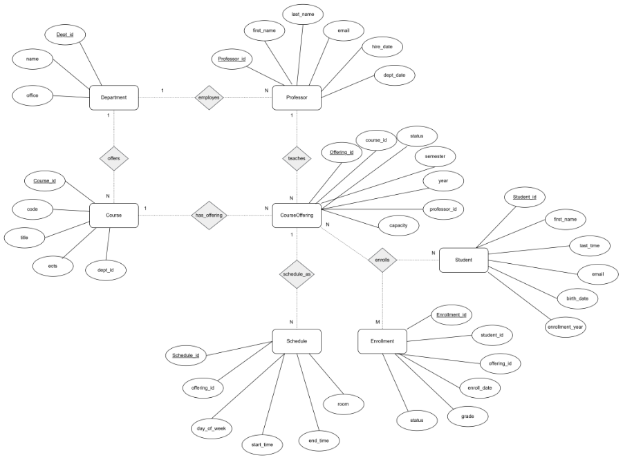
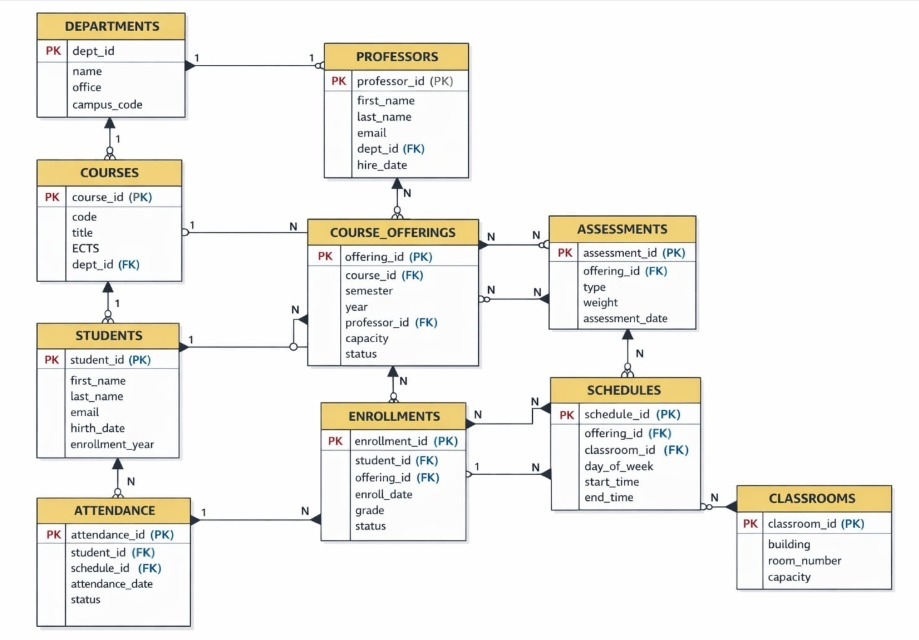

# University course enrolment database (MySQL)

Relational database for a university course-enrolment system: students, departments, professors, courses, course offerings, enrolments, timetables, classrooms, assessments and attendance — with sample data, queries and a transaction example.

Pair project by **Pedro Caldeira** and **Juan Bonilla** for the *Database Fundamentals* course (CTeSP in Web and Mobile Development, IPLUSO — Instituto Politécnico da Lusofonia, Lisbon). It was developed in two phases (Project 1 and Project 2), which together form this project.

## Contents

```
sql/phase1/schema_and_data.sql   Project 1: 7 tables, constraints, sample data, ALTER TABLE and index examples
sql/phase1/queries.sql           Project 1: 13 queries (filtering, pagination, joins, aggregation, subqueries, UPDATE, DELETE)
sql/phase2/schema_and_data.sql   Project 2: schema extended to 10 tables, sample data, index
sql/phase2/queries.sql           Project 2: queries plus a transaction with SAVEPOINT / ROLLBACK
docs/                            ER and logical diagrams of both phases
```

The SQL files are the project's original code, exported from DB-Fiddle (MySQL 9), where it was written and run. The only change is in the sample data: the names, e-mail addresses and birth dates of the students and professors were real and have been replaced with fictitious values. IDs and relationships are unchanged, and the fictitious surnames keep the original alphabetical order so the sorting and pagination queries behave the same way.

## Data model

**Project 1** — seven tables: `departments`, `professors`, `students`, `courses`, `course_offerings`, `enrollments`, `schedules`.

| Conceptual (ER) | Logical |
|---|---|
|  |  |

**Project 2** — ten tables: adds `classrooms` (schedules now reference a classroom instead of a free-text room), `assessments` and `attendance`.



The full ER diagram for project 2 is in [`docs/er-model-project2.png`](docs/er-model-project2.png).

Design decisions:

- `course_offerings` is separate from `courses`, because the same course can be offered in different semesters, years and by different professors.
- The many-to-many relation between students and offerings is the `enrollments` table, with its own attributes (date, grade, status) and a `UNIQUE (student_id, offering_id)` key.
- Surrogate `AUTO_INCREMENT` primary keys; natural candidate keys (e-mail, course code, building + room) are `UNIQUE`.
- `CHECK` constraints (ECTS between 1 and 6, grade between 0 and 20, start time before end time, positive capacity and weight), `ENUM` types for statuses, semesters and weekdays.
- Foreign keys with explicit actions: `ON DELETE CASCADE` for dependent records (enrolments, schedules, assessments, attendance) and `ON DELETE SET NULL` where the reference is optional (professor, department, classroom).

## Normalisation (project 2)

The course brief provided an unnormalised "enrolment activity" table, which was normalised step by step:

1. **UNF → 1NF:** cells contained several course codes, names, dates and professors separated by commas; values were made atomic, with one row per student–course combination.
2. **1NF → 2NF:** student attributes depended only on the student and course attributes only on the course (partial dependencies), so the data was split into students, courses and enrolments.
3. **2NF → 3NF:** department and professor attributes depended on the professor or course rather than on the enrolment (transitive dependencies), so professors and departments became separate tables, with `course_offerings` linking a course to a professor in a given semester and year.

## Queries and transaction

- Filtering, ordering and pagination (`WHERE`, `ORDER BY`, `LIMIT ... OFFSET`).
- `INNER JOIN` and `LEFT JOIN` across up to five tables.
- `GROUP BY` with `HAVING`.
- Subqueries with `IN`, including an `UPDATE` driven by a subquery (cancel an offering, then mark its enrolments as dropped).
- `DELETE` of an offering followed by checks that its enrolments and timetable entries were removed by `ON DELETE CASCADE`.
- Project 2 transaction: `START TRANSACTION` → insert an enrolment → `SAVEPOINT` → update the grade → `ROLLBACK TO SAVEPOINT` → `COMMIT`.

## Run locally

```bash
mysql -u root -p -e "CREATE DATABASE university_enrollment"
mysql -u root -p university_enrollment < sql/phase2/schema_and_data.sql
mysql -u root -p -t university_enrollment < sql/phase2/queries.sql
```

Use `sql/phase1/` instead for the first version. Each schema script drops and recreates its tables, and the query scripts modify data (`UPDATE`, `DELETE`), so reload the schema before running the queries again.

## Verification

Both phases were run on a local **MySQL 8.0.46** server (the original ran on MySQL 9 in DB-Fiddle):

- both schema scripts and both query scripts ran without errors;
- the query results match those described in the project reports: nine first-semester enrolments in the five-table join, two offerings with at least two students (3 each), one enrolment marked as dropped after the cancellation;
- after deleting offering 5, its enrolments and schedules were gone, and in project 2 the attendance rows for its schedule were removed as well (cascade through `schedules`);
- after the project 2 transaction, the new enrolment exists and its grade is `NULL`, confirming the rollback to the savepoint.

There is no automated test suite.

## Limitations

- The project 2 report also discusses access roles, backups and security practices; those were described in the report but are not part of the SQL code, so they are not included here.
- The `CREATE INDEX` is included, but no performance measurements were made.
- Running a query script twice without reloading the schema gives different results, because of the `UPDATE` and `DELETE` statements.
