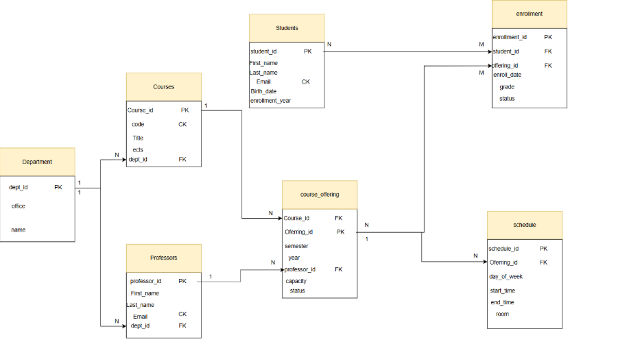

# University course enrolment database (MySQL)

Relational database design for a university course-enrolment system: students, departments, professors, courses, course offerings, enrolments, timetables, classrooms, assessments and attendance.

Pair project by **Pedro Caldeira** and **Juan Bonilla** for the *Database Fundamentals* course (CTeSP in Web and Mobile Development, IPLUSO — Instituto Politécnico da Lusofonia, Lisbon). It was developed in two phases (Project 1 and Project 2), which together form this project.

> **Repository status.** The full SQL (table creation and sample data) was written and run in DB-Fiddle (MySQL) and is not yet included here. This repository currently contains the data models and the queries exactly as they appear in the project reports. The schema script will be added once it has been exported from DB-Fiddle and its sample data replaced with fictitious records.

## Data model

**Project 1** — seven entities: `departments`, `professors`, `courses`, `course_offerings`, `students`, `enrollments` and `schedules`.

| Conceptual (ER) | Logical |
|---|---|
|  |  |

**Project 2** — the schema was extended to ten tables with `classrooms`, `assessments` and `attendance`:

The full ER diagram for project 2 is in [`docs/er-model-project2.png`](docs/er-model-project2.png).

Main design decisions (from the reports):

- `course_offerings` is separate from `courses`, because the same course can be offered in different semesters, years and by different professors.
- The many-to-many relation between students and offerings is implemented by `enrollments`, which has its own attributes (enrolment date, grade, status).
- Timetables (`schedules`) are a separate table, so an offering can have several sessions without duplicating offering data; in project 2 each session is linked to a classroom.
- Numeric surrogate primary keys (`AUTO_INCREMENT`); natural candidate keys such as e-mail and course code are `UNIQUE`.
- Integrity through `NOT NULL`, `UNIQUE`, `CHECK` and foreign keys with explicit `ON DELETE` actions (`CASCADE`, `SET NULL`).

## Normalisation (project 2)

The course brief provided an unnormalised "enrolment activity" table, which was normalised step by step:

1. **UNF → 1NF:** cells contained several course codes, names, dates and professors separated by commas; values were made atomic, with one row per student–course combination.
2. **1NF → 2NF:** student attributes depended only on the student and course attributes only on the course (partial dependencies), so the data was split into students, courses and enrolments.
3. **2NF → 3NF:** department and professor attributes depended on the professor or course rather than on the enrolment (transitive dependencies), so professors and departments became separate tables, with `course_offerings` linking a course to a professor in a given semester and year.

## Queries

[`sql/queries.sql`](sql/queries.sql) contains the thirteen queries from the Project 1 report, unchanged:

- filtering with `WHERE`, ordering and pagination with `ORDER BY`, `LIMIT` and `OFFSET`;
- `INNER JOIN` and `LEFT JOIN` across up to five tables;
- aggregation with `GROUP BY` / `HAVING`;
- subqueries with `IN`, including an `UPDATE` driven by a subquery;
- a `DELETE` followed by queries that check that dependent enrolments and timetable entries were removed by `ON DELETE CASCADE`.

Project 2 also used a transaction with `START TRANSACTION`, `SAVEPOINT`, `ROLLBACK` and `COMMIT` to enrol a student and record a grade; that script is part of the DB-Fiddle code.

## Limitations

- The schema and sample-data script is not included yet (see the status note above), so the queries cannot be run from this repository alone.
- The original sample data used names of real people; it will be replaced with fictitious data before publication, and query results are therefore not reproduced here.
- The project 2 report also discusses access roles, backups, indexing and security practices. Those parts are not documented here because the corresponding scripts are not in this repository.
